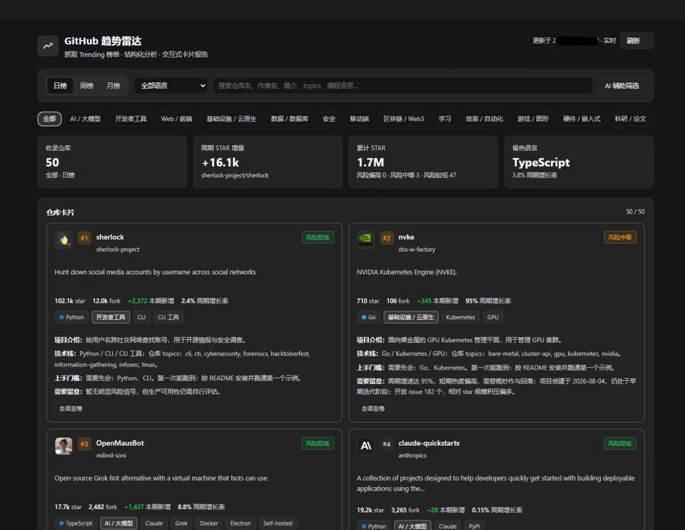

# GitHub Trending Radar Plus · dsh-github-trending-plus

[中文](README.md) · [English](README.en.md)

A long-lived Cordis plugin for DeepSeek Harness: it scrapes GitHub Trending (daily / weekly / monthly, optionally filtered
by programming language), runs a structured analysis on every repository (intro, tech stack, watch-outs, onboarding needs),
and renders the result as a browsable, pageable, filterable card report inside the Harness Web UI. It also registers a
tool, a slash command and an HTTP route. A report holds up to 50 repositories: the first 10 are deep cards, the rest are
compact cards. The board snapshot appears first and the full details follow.



## How it differs from the original

| | Original Royalsan/dsh-github-trending | This version |
| --- | --- | --- |
| Items | 15 per report | 50 per report; when the all-language board falls short, multi-language boards fill the gap and those cards are marked "Other language board" |
| Categories | 11, including "Other" | 13, with "Other" removed |
| Card content | Summary, star gain, growth chart, highlights, who it suits and more | Intro (1–2 Chinese sentences), tech stack, watch-outs, onboarding needs (what you need to know first / what you can run on the first try); no growth chart, highlights or "who it suits" |
| Chinese README | No badge | A badge when the repository has a Chinese README |
| Network | You had to enable a proxy yourself when the connection failed | Detects the Windows system proxy (Clash and similar), a local TLS man-in-the-middle (Steam++ and similar), and direct/DoH automatically; no manual setup; failures report "N attempts, elapsed time" |
| Loading | One wait for everything | The 50 board cards appear first (2–3 s when warm); full details for the first 10 arrive ten to twenty-odd seconds later, with a hint above the list |
| AI | None | Model-written Chinese intros (template first, replaced later); AI-assisted search (describe a project in one sentence, with match score and reason, confirmation before sending) |
| Search | Repository name, description or tags | Repository name, owner, description, topics, programming language; search results are grouped separately and marked "From search · not in this board" |
| First run | No guidance | A first-run dialog explains the three setups plus two illustrated tutorials (GitHub token setup, how to create an AI key); a complete beginner can follow them without guessing, and both can be skipped |
| Quota | 60 requests/hour anonymously | GitHub token support (60 → 5000 requests/hour); READMEs are fetched through `raw.githubusercontent.com` and do not consume API quota |
| Package name | `@royalsan/dsh-github-trending` | `dsh-github-trending-plus` |

Forked from Royalsan/dsh-github-trending; the original is the foundation of this project.

## Features

- **Trending scraping**: `daily` / `weekly` / `monthly`, 23 common languages; parses total stars, forks, period gain, contributors and language color. When the all-language board has fewer than 50 entries, multi-language boards fill the gap and those cards show their source.
- **Structured analysis** (deterministic rules; AI only rewrites the intro and onboarding):
  - intro: official description plus a cleaned README excerpt, 1–2 Chinese sentences
  - stack: language ecosystem, topic-to-technology mapping, name/description/README keywords
  - watch-outs: small star base, overheated growth, very new project, archived, missing license, issue backlog, single-maintainer risk, missing information
  - onboarding needs: what you should know first, what you can run on the first try
  - 13 category boards: AI / LLM, Developer tools, Web / frontend, Infra / cloud native, Data / database, Security, Mobile, Blockchain / Web3, Game / graphics, Hardware / embedded, Research, Learning, Productivity / automation; there is no "Other", and a repository that matches nothing gets no category chip
- **Two-stage loading**: the panel first shows the 50 board cards (2–3 s when warm, up to about 10 s right after start); full details for the first 10 cards (README excerpt, license, onboarding) arrive ten to twenty-odd seconds later, with a line above the list while they load. Nothing goes blank and no error is shown during this window.
- **AI**:
  - Model-written Chinese intros and onboarding: template text appears first and is replaced in place when the model replies; without a key or on failure the template stays and the board is unaffected.
  - AI-assisted search: describe a project in one sentence; results are ranked by match score with a reason for each; a confirmation dialog lists what will be sent before the first request. A failed request only shows an error; the board keeps rendering as before.
- **Interactive report panel**: the "GitHub Trending" sidebar icon opens a main panel with KPI tiles, a period switch, a language selector, search, 13 category chips, custom boards and paginated repo cards (6 per page). The first 10 cards render the full deep layout; from card 11 on the panel renders compact cards with only name, description, metrics and tags. A repository whose README is Chinese gets a "Chinese README" badge.
- **Search**: repository name, owner, description, topics and programming language; results are grouped separately and marked "From search · not in this board".
- **First-run guidance**: the first launch shows a dialog with the three setups (nothing / GitHub token / AI key) and two illustrated tutorials (why a GitHub token should expire in 90 days, how to create an AI key); both can be skipped, and a "don't show again" checkbox hides the dialog later.
- **Report data**: Mermaid source for a `xychart-beta` gain chart and a `pie` share chart travels with the structured data returned by `GET /dsh-github-trending/report`, for scripts and re-rendering; the panel itself does not display it.
- **Multiple entry points**: the `github_trending` tool, the `/github-trending [daily|weekly|monthly] [language]` command and `GET /dsh-github-trending/report`.

## Requirements

Node.js 22.13 or newer (see `engines` in `package.json`). The repository ships the built output, so installing does not require a build; only source changes need `node build.mjs`.

## Install

All three channels install the same package; pick one. The install writes the package into the current profile's `package.json` and `cordis.patch.yml` (`- insert: - id: dsh-github-trending-plus`) and takes effect in the Harness Web UI: a "GitHub Trending" sidebar entry, `github_trending` in the tool list and `/github-trending` in the command palette.

### Channel 1: GitHub (recommended)

```text
plugin_manager(action="install_bundle", target="github:Night-Leaf/dsh-github-trending-plus")
```

The repository root is the package root, so it works as-is.

### Channel 2: Local path

```text
plugin_manager(action="install_bundle", target="D:/path/to/dsh-github-trending-plus")
```

Replace `target` with the absolute path of this repository on your machine (on Windows both `D:/...` and `D:\\...` work).

### Channel 3: npm (not published yet)

The package is not on the npm registry, so this channel is not available yet; use GitHub or a local path for now.

You can also mount it as an ordinary Cordis plugin by hand; see `cordis.yml`.

## Upgrading and uninstalling

**Upgrade**: on the GitHub channel, run the install command again to overwrite the old copy:

```text
plugin_manager(action="install_bundle", target="github:Night-Leaf/dsh-github-trending-plus")
```

For a local-path install, `pnpm remove dsh-github-trending-plus` in the profile directory first, then install the new path through the channel above.

- **Restart DSH** afterwards; the panel only loads the new `client.js` and `lib/**` on a fresh start.
- Coming from the original `@royalsan/dsh-github-trending`: `pnpm remove @royalsan/dsh-github-trending`, drop the old package from `dsh.profile.bundles` in the profile `package.json`, then install this version through the channel above.
- Uninstall: `pnpm remove dsh-github-trending-plus`, remove `dsh-github-trending-plus` from `dsh.profile.bundles`, then restart DSH.
- Roll back: copy the whole package directory before upgrading; to roll back, copy it back into `node_modules/dsh-github-trending-plus/` and restart DSH.

## Configuration

`apply(ctx, config)` accepts these fields (all optional, all with defaults):

| Name | Type | Default | Purpose |
| --- | --- | --- | --- |
| `token` | string | `$GITHUB_TOKEN` / `$GH_TOKEN` | Optional GitHub token that raises the API quota (60 requests/hour unauthenticated, 5000 authenticated). **Never commit a token**; pass it through the environment |
| `defaultSince` | `daily` \| `weekly` \| `monthly` | `daily` | Period used when the tool or command omits one |
| `defaultLimit` | number | `50` | Repositories per report, 3–50 |
| `deepCount` | number | `10` | How many leading cards render as deep cards, 1–50; the rest are compact cards |
| `defaultFocus` | number | `3` | Repositories that get the extended deep-dive, 1–6 |
| `customBoards` | array | `[]` | Custom boards, up to 6; each board holds up to 20 keywords matched against name/description/topics text |
| `networkMode` | `auto` \| `manual` \| `off` | `auto` | `auto` = automatic discovery (system proxy / local MITM / direct + DoH fallback); `manual` = `proxyUrl` only; `off` = direct only |
| `proxyUrl` | string | `''` | Proxy URL used by `manual`, and preferred by `auto` when set |
| `dohEndpoints` | string[] | 4 built-in DoH endpoints | DNS-over-HTTPS endpoints tried in order; `{host}` is replaced with the domain |
| `candidateIPs` | object | `{}` | Extra candidate addresses per host, e.g. `{ "github.com": ["1.2.3.4"] }`, merged with the built-ins and de-duplicated |
| `forceDirect` | boolean | `false` | Force direct connections only; do not read the system proxy or try a local MITM |
| `caPath` | string | `''` | Cache path for the local MITM root certificate; empty uses the default (Windows: `%USERPROFILE%\.dsh\github-trending-ca.pem`) |
| `totalBudgetMs` | number | `25000` | Total network budget per report in milliseconds, range 5000–25000 |
| `installQuality` | `pass` \| `degraded` | `pass` | Installation quality marker; `degraded` shows a "degraded install (probe not fully passed)" banner |
| `sortWeights` | object | `{ match: 0.6, growth: 0.4 }` | Ranking weights for AI-assisted sorting |
| `searchFallback` | boolean | `true` | Whether to fill gaps with GitHub Search when AI matches are scarce |
| `searchThreshold` | number | `5` | AI match count below which search fallback runs |
| `readmeBadge` | boolean | `true` | Whether to show the "Chinese README" badge |
| `aiBaseURL` | string | `''` | External AI base URL, e.g. `https://api.openai.com/v1`; empty uses `https://api.deepseek.com` |
| `aiModel` | string | `''` | External AI model id; empty uses `deepseek-flash` |
| `aiKeyEnv` | string | `DSH_GITHUB_TRENDING_AI_KEY` | Environment variable that holds the AI key; the key itself is never stored in config |

Set them under `config:` in `cordis.yml` or the bundle patch; prefer an environment variable for `token`.

### Two ways to configure the AI key

Model-written Chinese intros and onboarding need an API key. The plugin resolves it in this order — **environment variables first, key file as fallback**:

1. Environment variable `DSH_GITHUB_TRENDING_AI_KEY`
2. Environment variable `DEEPSEEK_API_KEY`
3. Key file

Key-file path: the `DSH_GITHUB_TRENDING_AI_KEY_FILE` environment variable when set; otherwise the default:

- Windows: `%USERPROFILE%\.dsh\github-trending-ai-key`
- macOS / Linux: `~/.dsh/github-trending-ai-key`

The file content is the key itself (surrounding quotes, whitespace and a UTF-8 BOM are tolerated and stripped). A missing, empty or unreadable file means "not configured": the panel keeps the template intro and nothing throws.

The file fallback exists for a common Windows case: after `setx`, an already-running Explorer / DSH process can still hold the old environment snapshot and will not see the new value. Writing the key to a file avoids a full restart.

Create the default key file (run this in a new terminal opened after `setx`; the output never prints the key):

```powershell
$dir = Join-Path $env:USERPROFILE '.dsh'
New-Item -ItemType Directory -Force -Path $dir | Out-Null
Set-Content -Path (Join-Path $dir 'github-trending-ai-key') -Value $env:DSH_GITHUB_TRENDING_AI_KEY -NoNewline -Encoding ascii
```

macOS / Linux:

```bash
mkdir -p "$HOME/.dsh"
printf '%s' "$DSH_GITHUB_TRENDING_AI_KEY" > "$HOME/.dsh/github-trending-ai-key"
chmod 600 "$HOME/.dsh/github-trending-ai-key"
```

**Never commit the key**: keep the key file in your home directory, not in the package directory, and do not put it in `cordis.yml`, the bundle patch, or any file that will be committed.

## Network

Three routes are tried automatically to reach `github.com`, and **by default you do not need to edit hosts or enable a proxy first**:

1. **System proxy**: reads the Windows proxy settings (Clash, Clash Verge and similar tools with "System proxy" turned on), plus `HTTPS_PROXY` / `NO_PROXY`.
2. **Local TLS man-in-the-middle**: accelerators such as Steam++ / Watt Toolkit that point `github.com` at the local machine and replace certificates. The plugin exports the matching root certificate from the system store and caches it for reuse; if the first attempt reports a certificate error, one retry usually fixes it.
3. **Direct + DoH**: try direct first; on failure resolve the domain through `dohEndpoints` (4 built-in endpoints), then retry with built-in candidate IPs and any addresses in `candidateIPs`. TLS SNI and the HTTP `Host` header keep the original domain, so switching IPs does not break certificate validation.

If all three fail, the plugin falls back to the host's own web fetch channel so the panel still has data when possible. A failed report returns an explicit "N attempts, X seconds" error with a Retry button instead of a blank panel.

`networkMode: auto` is the automatic discovery above; `manual` uses `proxyUrl` only; `off` is direct only. Change these two fields only when you really want to pin a proxy.

## Usage

```text
/github-trending                       # today, all languages
/github-trending weekly rust           # this week, Rust
```

The equivalent tool call:

```json
{ "since": "weekly", "language": "rust", "limit": 50, "focus": 4, "refresh": false }
```

HTTP route (same origin, used by the panel and by scripts):

```text
GET /dsh-github-trending/report?since=daily&language=&limit=50&focus=3&refresh=0
```

It returns the report as JSON: `since` / `language` / `generatedAt` / `repos[]` (with analysis fields) / `summary` /
`mermaid` / `shortfall` / `shortfallReason` / `apiCalls` / `lastVia` / `networkStatus` / `deepCount` / `catalog` /
`customBoards` / `installQuality`.

Caching: reports for 10 minutes (concurrent requests for the same period are coalesced) and GitHub API facts for 6 hours. After a 403/429 the enrichment step is skipped for 5 minutes and the panel keeps rendering from the Trending page alone.

## FAQ

### Why does the panel take a while to open?

The first screen is the board snapshot: 2–3 seconds when warm, up to about 10 seconds right after start. Full details for the first 10 cards (README excerpt, license, onboarding) need another ten to twenty-odd seconds, and a line above the list says so. The model-written intro is requested only after the full details arrive, so it lands later — tens of seconds on a slow link. It only swaps text: cards never go blank and no error is shown while waiting.

### Why is Steam++ slower than a normal proxy?

Steam++ performs TLS man-in-the-middle on the local machine: each request goes to the local listener, is decrypted, then forwarded, adding one hop per request. That is inherently slower than a direct connection or a normal proxy; the overhead belongs to the route, not to the plugin hanging. Prefer direct or a system proxy when speed matters.

## Layout

```
index.js            host side: tool, command, HTTP routes (registered in apply, disposed via ctx.effect)
client.js           client side: sidebar.panellist icon + main panel component (window.__ModuleLoader__)
lib/trending.js     GitHub Trending HTML fetching and parsing
lib/http.js         transport: direct / DoH + candidate IPs / proxy / local MITM / Harness web fallback
lib/net.js          DoH resolution, candidate addresses, proxy selection and the CONNECT tunnel
lib/enrich.js       GitHub API + README enrichment (concurrency pool, cache, rate-limit cooldown)
lib/analyze.js      categories, stack, watch-outs, onboarding and deep-card copy
lib/categories.js   13-board catalogue and multi-label classification
lib/systemCa.js     exports and caches the local accelerators root certificate
lib/search.js       GitHub Search fallback
lib/translate.js    model-written Chinese intros (OpenAI-compatible endpoint)
lib/ai.js           AI-assisted search: scoring, ordering, status
lib/zh.js           Chinese summaries and the topic glossary
lib/ai-models.js    AI model-name detection from description/topics/README
lib/render.js       summary and Mermaid chart builders
lib/report.js       orchestration, cache, argument normalization
src/                TypeScript sources (one-to-one with the .js files)
build.mjs           emits .js via node:module stripTypeScriptTypes
test/               host, client, network, config and preview tests
```

## Development

```powershell
node build.mjs                 # src/**.ts -> sibling .js
node build.mjs --check         # check that the emitted files match src/ without writing
node --test "test/*.test.mjs"     # every offline test (quote the glob on Node 24)
node test/config.test.mjs          # offline assertions for name, release coordinates, README, LICENSE and locale
node test/net.test.mjs             # network layer: DoH, candidate IPs, retries, proxy tiers
node test/egress-v3.test.mjs       # system proxy / CONNECT probe / local MITM / budget and config
node test/route-enrich.test.mjs    # the /report enrich tiers and the recent-report cache
node test/boards.test.mjs --fixtures test/fixtures/trending
node test/categories.test.mjs --fixture test/fixtures/repos/categories.json
node test/cards.test.mjs --fixture test/fixtures/repos/cards.json
node test/client-panel.test.mjs --fixtures test/fixtures/client
node test/client-cards.test.mjs --fixture test/fixtures/client/report-50.json
node test/client-translate.test.mjs   # template first, model copy replaces it later
node test/client-ai.test.mjs          # AI filter panel, first-run dialog and tutorials
node test/smoke-host-offline.mjs
```

## License

MIT, see [LICENSE](LICENSE). This project is forked from <https://github.com/Royalsan/dsh-github-trending> and keeps the
original author's copyright notice.

Thanks again to Royalsan for the solid foundation; if this project is useful to you, consider giving the original
repository a star.
