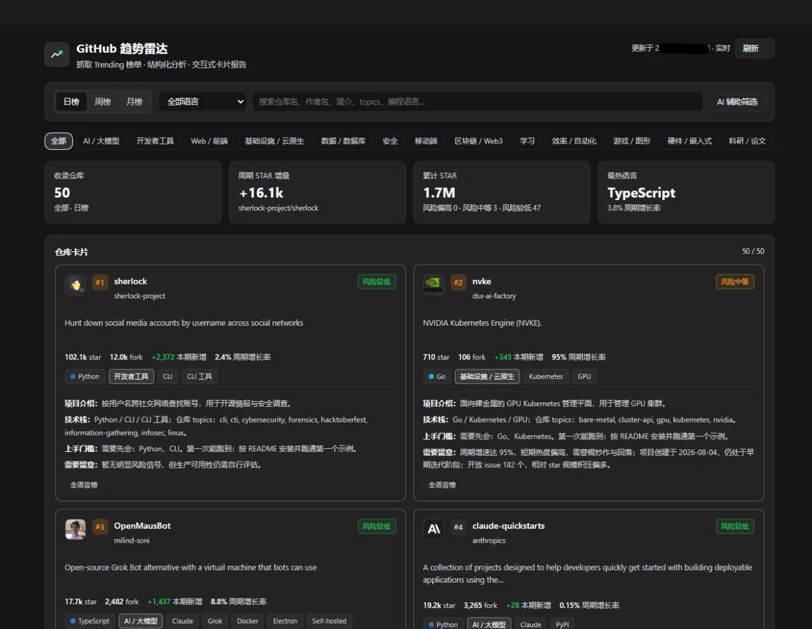

# GitHub 趋势雷达增强版 · dsh-github-trending-plus

[中文](README.md) · [English](README.en.md)

一个可长期安装的 Cordis 插件：抓取 GitHub Trending 日榜 / 周榜 / 月榜（支持按编程语言筛选），
对每个仓库做结构化分析（项目介绍、技术栈、需要留意、上手门槛），并在 Harness Web UI 里渲染成
可浏览、可翻页、可筛选的卡片报告；同时注册工具、命令与 HTTP 路由。
单次报告最多 50 条，前 10 张是深卡、其余是简卡；首屏先出榜单快照，完整信息随后补上。



## 和原版有什么不一样

|           | 原版 （Royalsan/dsh-github-trending） | dsh-github-trending-plus                                                               |
| --------- | --------------------------------- | -------------------------------------------------------------------------------------- |
| 条数        | 一次 15 条                           | 一次 50 条；全语言榜不够时用多语言榜补位，补位卡片标「其他语言榜补位」                                                  |
| 分类        | 11 类，含「其他」                        | 13 类，去掉「其他」                                                                            |
| 卡片内容      | 项目简介、star 增量、增长曲线、值得关注、适合谁等       | 项目介绍（1–2 句中文）、技术栈、需要留意、上手门槛（需要先会什么 / 第一次能跑到什么）；不再有增长曲线、值得关注、适合谁                        |
| 中文 README | 无标识                               | 仓库带中文 README 时显示徽章                                                                     |
| 网络        | 连不上要自己开代理                         | 自动识别 Windows 系统代理（Clash 这类）、本机 TLS 中间人（Steam++ 这类）、直连/DoH；不用手动配；失败会给出「已尝试 N 次、耗时」的明确报错 |
| 加载        | 一次等到底                             | 首屏先出 50 张榜单卡（热 2–3 秒），前 10 张的完整信息十几到二十几秒后补上，列表上方有一行提示                                  |
| AI        | 无                                 | 模型写中文项目介绍（先出模板、后替换）；AI 辅助筛选（一句话找项目，带匹配度与理由，发送前弹确认）                                     |
| 搜索        | 仓库名、简介或标签                         | 仓库名、作者名、简介、topics、编程语言；搜索结果单独分组标「来自搜索 · 非本期榜单」                                         |
| 首次使用      | 无引导                               | 首跑弹窗讲清三种配法 + 两条图文教程（GitHub token 配置、AI key 怎么建），零基础也能无脑跟着做                             |
| 配额        | 匿名 60 次/小时                        | 支持 GitHub token（60 → 5000 次/小时）；README 走 `raw.githubusercontent.com`，不占 API 配额         |
| 包名        | `@royalsan/dsh-github-trending`   | `dsh-github-trending-plus`                                                             |

Fork 自 Royalsan/dsh-github-trending，原版是这个项目的基础。

## 功能

- **榜单抓取**：`daily` / `weekly` / `monthly` 三个周期，23 种常用编程语言筛选；解析 star 总数、fork、周期增量、贡献者、语言色。全语言榜不够 50 条时用多语言榜补位，补位卡片会标出来源。
- **结构化分析**（确定性规则引擎，AI 只负责重写项目介绍与上手门槛）：
  - 项目介绍：官方 description + README 摘要清洗，1–2 句中文
  - 技术栈：语言 → 生态、topics → 技术映射、名称/简介/README 关键词
  - 需要留意：star 基数偏小、增速过热、项目过新、归档、license 缺失、issue 积压、单点维护、信息缺失
  - 上手门槛：需要先会什么、第一次能跑到什么
  - 13 类板块：AI / 大模型、开发者工具、Web / 前端、基础设施 / 云原生、数据 / 数据库、安全、移动端、区块链 / Web3、游戏 / 图形、硬件 / 嵌入式、科研 / 论文、学习、效率 / 自动化；没有「其他」，匹配不上的仓库不贴板块标签
- **两段加载**：打开面板先出 50 张榜单卡（热的时候 2–3 秒，刚启动最慢约 10 秒），前 10 张的完整信息（README 摘要、许可证、上手门槛）在十几到二十几秒后补上；列表上方有一行提示，期间不空白、不报错。
- **AI**：
  - 模型写中文项目介绍与上手门槛：先用模板文字占位，模型返回后原地替换；没配 key 或请求失败时保持模板，不影响榜单。
  - AI 辅助筛选：输入一句话找项目，结果按匹配度排序，每条给出匹配度与理由；第一次发送前弹确认，说明会发送哪些内容；请求失败只提示错误，榜单照常显示。
- **交互式报告面板**：侧边栏「GitHub 趋势」图标 → 主面板卡片页，含 KPI 概览、周期切换、语言下拉、搜索、13 类板块 chip、自定义板块与仓库卡片分页（每页 6 条）。前 10 张渲染完整深卡，第 11 张起是只保留名称、简介、指标与标签的简卡；中文 README 显示「中文 README」徽章。
- **搜索**：支持仓库名、作者名、简介、topics、编程语言；搜索结果单独分组，标「来自搜索 · 非本期榜单」。
- **首次使用引导**：第一次打开会弹窗讲清三种配法（什么都不配 / GitHub token / AI key），附两条图文教程（GitHub token 为什么选 90 天、AI key 怎么建），都能跳过；勾「下次不再提示」后不再出现。
- **报告数据**：`xychart-beta` 增量柱状图与 `pie` 占比的 Mermaid 源码，连同结构化仓库数据一起由 `GET /dsh-github-trending/report` 的 JSON 返回，供脚本或二次渲染使用；面板本身不展示这些源码。
- **多入口**：工具 `github_trending`、命令 `/github-trending [daily|weekly|monthly] [language]`、`GET /dsh-github-trending/report`。

## 环境要求

需要 Node.js 22.13 或更高版本（见 `package.json` 的 `engines`）。仓库里已带构建产物，安装时不需要自己编译；改源码时才要跑 `node build.mjs`。

## 安装

三条渠道装的是同一份包，任选一条。安装会把包写入当前 profile 的 `package.json` 与 `cordis.patch.yml`（`- insert: - id: dsh-github-trending-plus`），并在 Harness Web UI 中生效：侧边栏出现「GitHub 趋势」面板入口，工具列表出现 `github_trending`，命令面板出现 `/github-trending`。

### 渠道一：GitHub（推荐）

```text
plugin_manager(action="install_bundle", target="github:Night-Leaf/dsh-github-trending-plus")
```

仓库根目录就是包根，装上即用。

### 渠道二：本地路径

```text
plugin_manager(action="install_bundle", target="D:/path/to/dsh-github-trending-plus")
```

`target` 换成你机器上本仓库的绝对路径（Windows 用 `D:/...` 或 `D:\...` 均可）。

### 渠道三：npm（暂未发布）

包还没有发布到 npm registry，这条渠道暂时不可用；需要时先用 GitHub 或本地路径安装。

也可以把本包当作普通 Cordis 插件手动加载，参考 `cordis.yml`。

## 升级与卸载

**升级**：走 GitHub 渠道时，再执行一次安装命令覆盖旧副本即可：

```text
plugin_manager(action="install_bundle", target="github:Night-Leaf/dsh-github-trending-plus")
```

本地路径安装的话，先在 profile 目录 `pnpm remove dsh-github-trending-plus`，再按上面的渠道安装新路径。

- 装完要**重启 DSH**，面板才会加载新的 `client.js` 与 `lib/**`。
- 从原版 `@royalsan/dsh-github-trending` 迁过来：先 `pnpm remove @royalsan/dsh-github-trending`，再把旧包从 profile 的 `dsh.profile.bundles` 里删掉，然后按上面的渠道安装这个版本。
- 卸载：`pnpm remove dsh-github-trending-plus`，并从 `dsh.profile.bundles` 里去掉 `dsh-github-trending-plus`，然后重启 DSH。
- 回滚：升级前把整个包目录复制一份；需要回滚时复制回 `node_modules/dsh-github-trending-plus/`，重启 DSH。

## 配置

`apply(ctx, config)` 支持以下字段（均有默认值）：

| 名称                | 类型                               | 默认值                           | 说明                                                                                  |
| ----------------- | -------------------------------- | ----------------------------- | ----------------------------------------------------------------------------------- |
| `token`           | string                           | `$GITHUB_TOKEN` / `$GH_TOKEN` | 可选 GitHub token，用于提升 API 限额（未认证 60 次/小时，认证后 5000 次/小时）。**不要把 token 写进仓库**，用环境变量传入即可 |
| `defaultSince`    | `daily` \| `weekly` \| `monthly` | `daily`                       | 工具/命令未指定周期时使用                                                                       |
| `defaultLimit`    | number                           | `50`                          | 单次报告抓取条数，范围 3–50                                                                    |
| `deepCount`       | number                           | `10`                          | 前多少张卡片渲染为深卡，范围 1–50；其余为简卡                                                           |
| `defaultFocus`    | number                           | `3`                           | 深度融合解读的仓库数，范围 1–6                                                                   |
| `customBoards`    | array                            | `[]`                          | 自定义板块，最多 6 个；每个板块最多 20 个关键词，按仓库名/描述/topics 等合并文本匹配                                  |
| `networkMode`     | `auto` \| `manual` \| `off`      | `auto`                        | `auto` = 自动识别（系统代理 / 本机中间人 / 直连 + DoH 兜底）；`manual` = 只用 `proxyUrl`；`off` = 只直连      |
| `proxyUrl`        | string                           | `''`                          | `manual` 模式使用的代理地址；`auto` 模式下设置后优先使用                                                |
| `dohEndpoints`    | string[]                         | 内置 4 个 DoH 端点                 | DNS-over-HTTPS 端点，按顺序回退；`{host}` 会被替换成域名                                            |
| `candidateIPs`    | object                           | `{}`                          | 按域名补充候选 IP，例如 `{ "github.com": ["1.2.3.4"] }`；与内置候选合并后去重                            |
| `forceDirect`     | boolean                          | `false`                       | 强制只走直连，不读系统代理、不试本机中间人                                                               |
| `caPath`          | string                           | `''`                          | 本机中间人根证书缓存路径；留空时用默认位置（Windows 为 `%USERPROFILE%\.dsh\github-trending-ca.pem`）        |
| `totalBudgetMs`   | number                           | `25000`                       | 单次报告的网络总预算（毫秒），范围 5000–25000                                                        |
| `installQuality`  | `pass` \| `degraded`             | `pass`                        | 安装质量标记；`degraded` 时面板显示「安装质量为降级（探针未全过）」                                             |
| `sortWeights`     | object                           | `{ match: 0.6, growth: 0.4 }` | AI 辅助排序权重                                                                           |
| `searchFallback`  | boolean                          | `true`                        | AI 命中不足时是否用 GitHub Search 补位                                                        |
| `searchThreshold` | number                           | `5`                           | AI 命中数低于该值时触发搜索兜底                                                                   |
| `readmeBadge`     | boolean                          | `true`                        | 是否显示「中文 README」徽章                                                                   |
| `aiBaseURL`       | string                           | `''`                          | 外部 AI 接口地址，例如 `https://api.openai.com/v1`；留空时用 `https://api.deepseek.com`           |
| `aiModel`         | string                           | `''`                          | 外部 AI 模型 id；留空时用 `deepseek-flash`                                                   |
| `aiKeyEnv`        | string                           | `DSH_GITHUB_TRENDING_AI_KEY`  | 保存 AI key 的环境变量名；key 本身不写进配置                                                        |

在 `cordis.yml` / bundle patch 里写 `config:` 即可覆盖；`token` 建议留给环境变量。

### 配置 AI key 的两种方式

AI 写的中文项目介绍与上手门槛需要一把 key。插件按以下顺序读取，**环境变量优先，文件兜底**：

1. 环境变量 `DSH_GITHUB_TRENDING_AI_KEY`
2. 环境变量 `DEEPSEEK_API_KEY`
3. key 文件

key 文件路径：优先取环境变量 `DSH_GITHUB_TRENDING_AI_KEY_FILE`；未设置时用默认路径：

- Windows：`%USERPROFILE%\.dsh\github-trending-ai-key`
- macOS / Linux：`~/.dsh/github-trending-ai-key`

文件内容就是 key 本身（允许带引号、首尾空白或 UTF-8 BOM，读取时会自动去掉）。文件不存在、内容为空或读取失败都按「未配置」处理：面板继续用模板简介，不报错。

环境变量优先是为了兼容 Windows 上的常见情况：用 `setx` 设过变量后，已经运行的 Explorer / DSH 进程仍可能持有旧的环境快照，读不到新值；这时把 key 写进文件即可，不必重启整个会话。

创建默认 key 文件的示例（在 `setx` 之后新开的终端里执行，输出不会打印 key）：

```powershell
$dir = Join-Path $env:USERPROFILE '.dsh'
New-Item -ItemType Directory -Force -Path $dir | Out-Null
Set-Content -Path (Join-Path $dir 'github-trending-ai-key') -Value $env:DSH_GITHUB_TRENDING_AI_KEY -NoNewline -Encoding ascii
```

macOS / Linux：

```bash
mkdir -p "$HOME/.dsh"
printf '%s' "$DSH_GITHUB_TRENDING_AI_KEY" > "$HOME/.dsh/github-trending-ai-key"
chmod 600 "$HOME/.dsh/github-trending-ai-key"
```

**不要把 key 提交进仓库**：key 文件放在用户目录，不要放进包目录，也不要写进 `cordis.yml`、bundle patch 或任何会被提交的文件。

## 网络说明

插件按三档自动选择访问 `github.com` 的路线，**默认不需要用户改 hosts，也不需要提前开代理**：

1. **系统代理**：读取 Windows 的代理设置（Clash、Clash Verge 这类开了「系统代理」的软件），也读 `HTTPS_PROXY` / `NO_PROXY`。
2. **本机 TLS 中间人**：Steam++ / Watt Toolkit 这类把 `github.com` 指到本机并替换证书的加速器。插件会从系统证书库导出匹配的根证书并缓存，之后复用；第一次报证书错误时重跑一次通常就好。
3. **直连 + DoH**：先直连；失败就用 `dohEndpoints`（内置 4 个 DoH 端点）解析域名，再用内置候选 IP 与 `candidateIPs` 里的地址换一个 IP 重试。TLS 的 SNI 与 HTTP 的 `Host` 始终保留原域名，不会因为换 IP 而报证书错误。

三条路都不通时，回退到宿主自身的 web fetch 通道，尽量让面板仍有数据。单次报告失败会直接给出「已尝试 N 次、耗时 X 秒」的报错和「重试」按钮，不会只留一个空白面板。

`networkMode: auto` 就是上面这套自动识别；`manual` 只用 `proxyUrl`；`off` 只直连。确实要固定代理时，才需要改这两项。

## 使用

```text
/github-trending                       # 今日榜，全语言
/github-trending weekly rust           # 周榜，Rust
```

工具调用等价于：

```json
{ "since": "weekly", "language": "rust", "limit": 50, "focus": 4, "refresh": false }
```

HTTP 路由（同源，供面板与外部脚本使用）：

```text
GET /dsh-github-trending/report?since=daily&language=&limit=50&focus=3&refresh=0
```

返回报告 JSON：`since` / `language` / `generatedAt` / `repos[]`（含分析字段）/ `summary` / `mermaid` /
`shortfall` / `shortfallReason` / `apiCalls` / `lastVia` / `networkStatus` / `deepCount` / `catalog` / `customBoards` / `installQuality`。

缓存：报告 10 分钟（同一周期的并发请求会合并），GitHub API 事实 6 小时；命中 403/429 后 5 分钟内跳过增强，
页面仍可用 Trending 页面本身的数据渲染。

## 常见问题

### 为什么打开面板要等一会儿？

首屏是榜单快照：热的时候 2–3 秒出来，刚启动最慢约 10 秒。前 10 张的完整信息（README 摘要、许可证、上手门槛）还要十几到二十几秒才补上，列表上方会有一行提示。AI 写的项目介绍要等完整信息到了才发请求，所以更晚出现，网络差的时候可能几十秒；它只替换文字，期间卡片不会空白，也不会报错。

### 为什么用 Steam++ 比一般梯子慢？

Steam++ 在本机做 TLS 中间人：请求要先到本机监听端口、解密、再转发，每个请求多一跳，所以比直连或普通代理慢。慢是这条路的固有开销，不是插件卡住；介意速度就优先用直连或系统代理。

## 结构

```
index.js            Host 侧：工具、命令、HTTP 路由（apply 注册，ctx.effect 清理）
client.js           客户端：sidebar.panellist 图标 + main 面板组件（window.__ModuleLoader__）
lib/trending.js     Trending HTML 抓取与解析
lib/http.js         传输层：直连 / DoH + 候选 IP / 代理 / 本机中间人 / Harness web 回退
lib/net.js          DoH 解析、候选地址、代理选择与 CONNECT 隧道
lib/enrich.js       GitHub API + README 增强（并发池、缓存、限流冷却）
lib/analyze.js      分类、技术栈、需要留意、上手门槛与深卡文案
lib/categories.js   13 类板块目录与多标签分类
lib/systemCa.js    本机加速器根证书导出与缓存
lib/search.js       GitHub Search 兜底
lib/translate.js    模型写中文项目介绍（OpenAI 兼容接口）
lib/ai.js           AI 辅助筛选：打分、排序、状态
lib/zh.js           中文摘要与话题词表
lib/ai-models.js    仓库简介/topics/README 里的 AI 模型名识别
lib/render.js       概览与 Mermaid 图表构建
lib/report.js       编排 + 缓存 + 参数归一化
src/                TypeScript 源码（与 .js 一一对应）
build.mjs           用 node:module stripTypeScriptTypes 生成 .js
test/               宿主端、客户端、网络、配置与预览测试
```

## 开发

```powershell
node build.mjs                 # src/**.ts → 同名 .js
node build.mjs --check         # 只检查产物是否与源码一致
node --test "test/*.test.mjs"   # 全部离线测试（Node 24 需要给 glob 加引号）
node test/config.test.mjs          # 包名、发布坐标、README、LICENSE、locale 的离线断言
node test/net.test.mjs             # 网络层：DoH、候选 IP、重试、代理三档
node test/egress-v3.test.mjs       # 系统代理 / CONNECT 探针 / 本机中间人 / 预算与配置
node test/route-enrich.test.mjs    # /report 的 enrich 分档与最近报表缓存
node test/boards.test.mjs --fixtures test/fixtures/trending
node test/categories.test.mjs --fixture test/fixtures/repos/categories.json
node test/cards.test.mjs --fixture test/fixtures/repos/cards.json
node test/client-panel.test.mjs --fixtures test/fixtures/client
node test/client-cards.test.mjs --fixture test/fixtures/client/report-50.json
node test/client-translate.test.mjs   # 模板先出、模型文案后替换
node test/client-ai.test.mjs          # AI 筛选面板、首跑弹窗与教程
node test/smoke-host-offline.mjs
```

## 许可

MIT，见 [LICENSE](LICENSE)。本项目 Fork 自 <https://github.com/Royalsan/dsh-github-trending>，保留原作者版权声明。


再次感谢原作者 Royalsan 提供的优秀基础；如果这个项目对你有用，也欢迎给原作者一个 star。
